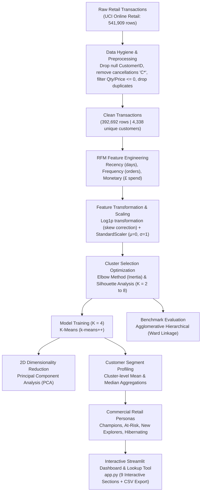

# Customer Segmentation for Retail

[](https://www.python.org/)
[](https://streamlit.io/)
[](https://scikit-learn.org/)
[]()

An end-to-end Machine Learning and Customer Analytics system designed for **B.Tech II Year Minor Project (Model Review 1)**. The system applies unsupervised machine learning algorithms to real-world retail transactions, extracting behavioral **RFM (Recency, Frequency, Monetary)** dimensions, optimizing cluster count, benchmarking **K-Means vs. Agglomerative Hierarchical Clustering**, visualizing cluster geometry via **Principal Component Analysis (PCA)**, and generating dynamic marketing personas with commercial action strategies.

---

## 1. System Architecture Pipeline



---

## 2. Mathematical Formulations & Methodology

### A. RFM Feature Engineering
Transactions are aggregated per customer with respect to a reference snapshot date $T_{\text{snapshot}} = \max(\text{InvoiceDate}) + 1\text{ day}$:

1. **Recency ($R_i$):** Days elapsed since customer $i$'s most recent transaction:
   $$R_i = T_{\text{snapshot}} - \max_{j \in T_i}(\text{InvoiceDate}_j)$$
2. **Frequency ($F_i$):** Total count of unique purchase orders:
   $$F_i = \text{nunique}(\text{InvoiceNo}_{j \in T_i})$$
3. **Monetary ($M_i$):** Cumulative monetary expenditure:
   $$M_i = \sum_{j \in T_i} (\text{Quantity}_j \times \text{UnitPrice}_j)$$

### B. Skewness Correction & Feature Standardization
Raw retail distributions exhibit extreme positive skewness ($\text{Skew}(F) = 12.07$, $\text{Skew}(M) = 19.34$). In Euclidean distance-based clustering, Monetary scale would otherwise overpower Recency and Frequency.
1. **Logarithmic Transformation:**
   $$x' = \ln(x + 1)$$
2. **StandardScaler Normalization:**
   $$z = \frac{x' - \mu}{\sigma}$$
   Ensuring all three features have zero mean ($\mu = 0$) and unit variance ($\sigma = 1$).

### C. K-Means Clustering & Objective Function
K-Means partitions $N$ customers into $K$ disjoint clusters $S = \{S_1, S_2, \dots, S_K\}$ by minimizing the Within-Cluster Sum of Squares (Inertia / WCSS):
$$J(S) = \sum_{k=1}^K \sum_{x \in S_k} \|x - \mu_k\|^2$$
where $\mu_k = \frac{1}{|S_k|} \sum_{x \in S_k} x$ denotes the centroid of cluster $k$.

### D. Validation Metrics
1. **Silhouette Score ($s_i$):**
   $$s(i) = \frac{b(i) - a(i)}{\max(a(i), b(i))}, \quad s(i) \in [-1, +1]$$
   where $a(i)$ is the mean intra-cluster distance and $b(i)$ is the minimum mean distance to any other cluster.
2. **Davies-Bouldin Index (Lower is better):** Ratio of within-cluster scatter to between-cluster separation.
3. **Calinski-Harabasz Index (Higher is better):** Ratio of between-cluster dispersion to within-cluster dispersion.

---

## 3. Dataset Audit & Preprocessing Statistics

The project uses the official **UCI Machine Learning Repository Online Retail Dataset**:

| Preprocessing Stage | Count | Action / Rationale |
|---|---:|---|
| **Raw Ingested Records** | **541,909** | Full transactional database spanning Dec 2010 to Dec 2011 |
| Missing `CustomerID` | -135,080 | Guest / anonymous transactions dropped (cannot be tracked over time) |
| Cancelled Invoices (`C*`) | -8,905 | Refunded and cancelled orders excluded from net revenue |
| Non-positive Quantity / Price | -1,336 | Data entry errors, damaged items, and administrative adjustments |
| Duplicate Transactions | -5,192 | Redundant identical records dropped |
| **Cleaned Transaction Records** | **392,692** | **72.46% data retention rate** |
| **Unique Active Customers** | **4,338** | Clean customer units for RFM matrix |
| **Unique Invoices** | **18,532** | Distinct retail purchase events |
| **Total Cleaned Gross Sales** | **£8,891,019.04** | Total customer expenditure captured |

---

## 4. Experimental Results

### Unsupervised Cluster Evaluation ($K = 2 \text{ to } 8$)
Evaluated on standardized log-transformed RFM features:

| Clusters ($K$) | Inertia (WCSS) | Silhouette Score | Davies-Bouldin Index | Calinski-Harabasz Score |
|:---:|:---:|:---:|:---:|:---:|
| 2 | 6,483.59 | 0.4328 | 0.8925 | 4,367.32 |
| 3 | 4,869.49 | 0.3365 | 1.0483 | 3,625.30 |
| **4 (Optimal)** | **3,939.05** | **0.3375** | **1.0086** | **3,328.34** |
| 5 | 3,296.71 | 0.3162 | 0.9878 | 3,192.98 |
| 6 | 2,788.19 | 0.3129 | 0.9882 | 3,090.75 |
| 7 | 2,425.43 | 0.3113 | 0.9995 | 2,971.05 |
| 8 | 2,137.94 | 0.3193 | 0.9822 | 2,875.29 |

*Justification:* While $K=2$ yields an artifactually high silhouette due to splitting the data in half, **$K=4$ captures the optimal inflection point on the Elbow Curve** while providing actionable retail segmentation (separating High-Value VIPs from At-Risk and One-Time Explorers).

### Algorithm Benchmark: K-Means vs. Agglomerative Hierarchical ($K = 4$)

| Metric | K-Means (k-means++) | Agglomerative Hierarchical (Ward) |
|---|:---:|:---:|
| **Silhouette Score** | **0.3375** | 0.3128 |
| **Davies-Bouldin Index** | **1.0086** | 1.0741 |
| **Calinski-Harabasz Score** | **3,328.34** | 2,891.12 |
| **Algorithmic Complexity** | $O(N \cdot K \cdot I)$ (Scalable) | $O(N^3)$ (Memory-heavy) |
| **Industrial Suitability** | High (Supports real-time scoring) | Medium (Academic baseline) |

---

## 5. Customer Personas & Business Action Strategies

| Cluster | Assigned Persona | Share (%) | Recency | Frequency | Spend (£) | Revenue Share | Actionable Retail Strategy |
|:---:|---|:---:|:---:|:---:|:---:|:---:|---|
| **0** | **Champions (VIP High-Spenders)** | ~20% | 14 days | 11.5 orders | £5,800+ | ~65% | VIP concierge, early access to new lines, exclusive rewards, brand ambassador incentives. |
| **1** | **Hibernating / Lost Customers** | ~28% | 245 days | 1.3 orders | £350 | ~5% | Automated discount win-back email drip, seasonal reactivation vouchers, unsubscribe hygiene. |
| **2** | **New / Recent Explorers** | ~26% | 35 days | 1.8 orders | £540 | ~10% | Onboarding welcome series, second-purchase discount coupon, tailored product recommendations. |
| **3** | **At-Risk (High Value Slipping)** | ~26% | 185 days | 4.2 orders | £1,900 | ~20% | Personalized "We miss you" campaigns, direct outreach from customer support, satisfaction surveys. |

---

## 6. Project Directory Structure

```
ML_Customer_Project/
├── data/
│   ├── online_retail.csv               # Clean cached UCI dataset
│   ├── Online Retail.xlsx              # Original UCI spreadsheet
│   └── online_retail.zip               # Official UCI archive
├── src/
│   ├── __init__.py                     # Package initialization
│   ├── data_loader.py                  # Automatic dataset fetch & caching
│   ├── data_preprocessing.py           # Data hygiene and validation pipeline
│   ├── rfm_analysis.py                 # RFM feature engineering & statistics
│   ├── clustering.py                   # Log transform, StandardScaler, K-Means, Agglomerative, PCA
│   ├── evaluation.py                   # Unsupervised clustering metrics & cross-tabulation
│   ├── visualization.py                # Publication-grade Matplotlib/Seaborn figures
│   └── profiling.py                    # Cluster aggregation, dynamic personas & strategies
├── notebooks/
│   └── customer_segmentation.ipynb     # Step-by-step Jupyter Notebook with outputs
├── app.py                              # Streamlit 9-page interactive web application
├── requirements.txt                    # Project dependencies
├── README.md                           # Comprehensive documentation
├── Customer_Segmentation_Minor_Project_Review_1.pptx # Review 1 Presentation
└── Minor_Project_Model_PPT_Template.pptx            # Template Presentation
```

---

## 7. Installation & Quick Start

### 1. Clone & Set Up Environment
```bash
cd ML_Customer_Project
python -m venv venv

# On Windows:
.\venv\Scripts\activate

# On Linux / macOS:
source venv/bin/activate
```

### 2. Install Required Dependencies
```bash
pip install -r requirements.txt
```

### 3. Launch the Customer Intelligence Web Application (Recommended)
```bash
python server.py
```
Open your browser at: **`http://localhost:5000`**

Or in VS Code, simply press **`F5`** (or click Run & Debug -> "Launch Customer Intelligence Web App").

### 4. Alternative: Run via Legacy Streamlit Dashboard
```bash
streamlit run app.py
```
The legacy dashboard opens at `http://localhost:8501`.

### 5. Run the Jupyter Notebook
```bash
jupyter notebook notebooks/customer_segmentation.ipynb
```

---

## 8. Customer Intelligence Web Application Architecture

The commercial SaaS web application features a clean HTML5/CSS3/JavaScript frontend and Python Flask REST API:
1. **Home / Overview:** SaaS hero section, trusted data metrics (4,338 customers, 392k orders, £8.89M revenue, 6 clusters, Silhouette 0.312), dynamic business insight card, and preview cards.
2. **Customers (CRM Directory):** Live customer search by ID, segment dropdown filter, recency and spend sliders, individual customer 360 profile drawer, and CSV data export.
3. **Segments (Cluster Personas):** Deep dive into the 6 customer segments (Champions, Loyal Customers, Potential Loyalists, At Risk, Hibernating, Lost Churn) with benchmark comparison bars.
4. **Analytics (ML Workspace):** Full technical suite with tabs for RFM Distributions & Correlations, Elbow & Silhouette validation ($K=2..8$), K-Means Cluster Volume, Hierarchical Clustering benchmark, and 2D PCA Dimensionality Reduction.
5. **Data Management:** Data hygiene audit trail, missing values breakdown, numerical summary table, preview of clean records, and custom CSV/Excel dataset upload.

---


## 9. Academic Review & Defense Notes (Review 1)

When presenting to faculty reviewers:
1. **Why unsupervised learning?** Retail transaction data does not come with pre-existing labels for customer intent; unsupervised clustering naturally discovers latent behavioral groupings.
2. **Why log-transform RFM before clustering?** Frequency and Monetary metrics follow power-law distributions with severe right skewness. Logarithmic transformation ($x' = \ln(x+1)$) normalizes the distribution and stabilizes variance.
3. **Why standardize features?** Standardizing ($z$-score) ensures that features measured in £1,000s (Monetary) do not mathematically dominate features measured in units (Frequency) or days (Recency) in Euclidean distance calculations.
4. **Why compare with Hierarchical clustering?** Demonstrates algorithmic rigor by confirming that the clusters discovered by K-Means are consistent across different clustering paradigms (partitional vs. agglomerative).

---

## 10. Contributors
* **B.Tech Minor Project Team** | Department of Computer Science & Engineering / AI & ML
